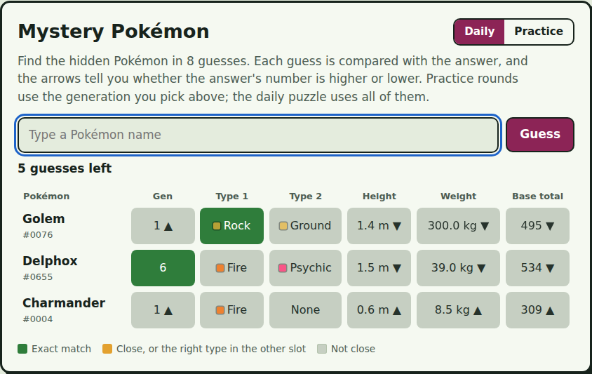
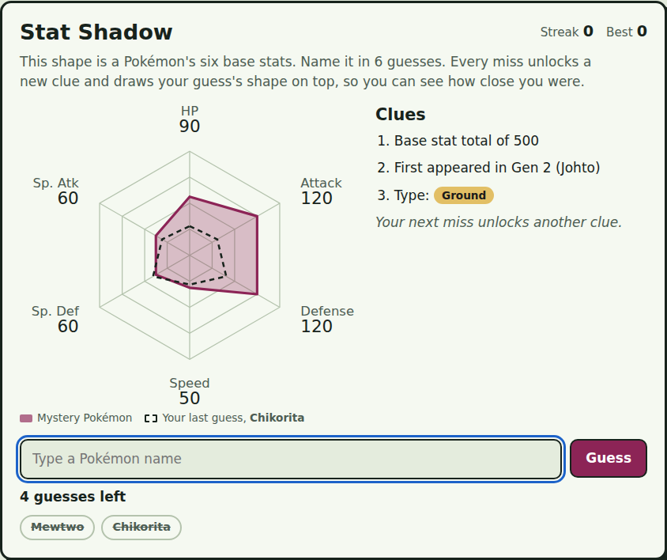
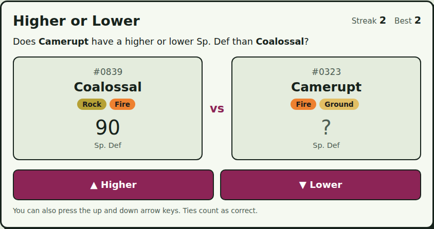
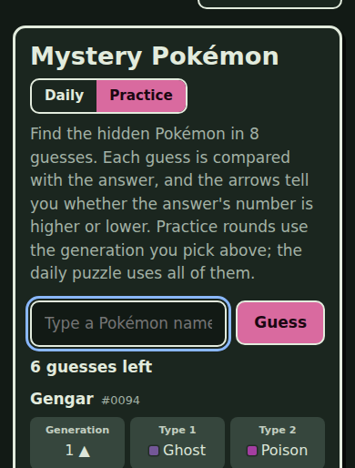

# 🔍 Dex Detective


Three Pokémon guessing games built from a dataset of all 1,025 Pokémon. Plain HTML, CSS and JavaScript: no framework, no build step, and a test suite that runs on every push.

**Play it:** https://TanmaySarfare.github.io/dex-detective/



## The games

- **Mystery Pokémon.** Find the hidden Pokémon in 8 guesses. Each guess is compared with the answer on generation, both types, height, weight and base stat total, with arrows pointing toward the answer. There's a daily puzzle that's the same for everyone, a shareable emoji result, and unlimited practice rounds.
- **Stat Shadow.** Name a Pokémon from its stat chart alone. Every miss unlocks a new clue and draws your guess's chart on top for comparison.
- **Higher or Lower.** Two Pokémon and a random stat. Guess whether the second one is higher or lower and keep the streak going.

You can also limit any practice game to a single generation. Daily progress and best streaks are saved in the browser, and the page works on phones, in light and dark mode, and with a keyboard or screen reader.

| Stat Shadow | Higher or Lower | On a phone |
| --- | --- | --- |
|  |  |  |

## How it works

- **Logic separate from the page.** The game rules in [`js/logic.js`](js/logic.js) are pure functions with no access to the page, so they can be unit-tested in Node. The files in `js/games/` handle only drawing and user input.
- **A daily puzzle without a server.** Today's date is hashed (FNV-1a) to seed a small random number generator (mulberry32), which picks the answer. Everyone gets the same Pokémon on the same day, and nothing has to be stored online.
- **Stat charts drawn from data.** The Stat Shadow chart is an SVG built from the six base stats, with your last guess overlaid as a dashed outline.
- **A data pipeline.** The data starts in an Excel workbook. [`scripts/build_data.py`](scripts/build_data.py) checks it (valid types, stat ranges, duplicate numbers) and writes [`data/pokemon.json`](data/pokemon.json), one Pokémon per line so Git diffs stay readable.
- **CI/CD.** A GitHub Actions workflow runs the tests on every push and pull request, and deploys to GitHub Pages only when they pass on `main`.

## Project structure

```
dex-detective/
├── index.html               Page markup
├── css/styles.css           Styles, with light and dark colour themes
├── js/
│   ├── main.js              Loads the data and wires everything together
│   ├── logic.js             Game rules as pure, tested functions
│   ├── dom.js               Small page helpers (cards, badges, toasts)
│   ├── picker.js            Name search with suggestions
│   ├── storage.js           Saves progress in the browser
│   └── games/               One file per game
├── data/
│   ├── pokemon.json         Game data (generated)
│   └── source/              Put your workbook here (not uploaded)
├── scripts/build_data.py    Excel → JSON with validation
├── tests/logic.test.js      Unit tests (Node's built-in test runner)
└── .github/workflows/       Test and deploy pipeline
```

## Run it locally

```bash
git clone https://github.com/TanmaySarfare/dex-detective.git
cd dex-detective
python3 -m http.server 8000
```

Then open http://localhost:8000. Opening `index.html` directly from your file browser won't work, because browsers block JavaScript modules on pages loaded from disk.

## Run the tests

Requires Node.js 20 or newer. There's nothing to install.

```bash
npm test
```

## Update the data

1. Copy your Excel workbook into `data/source/`. It's listed in `.gitignore`, so it stays on your computer.
2. Rebuild the JSON:

   ```bash
   pip install -r scripts/requirements.txt
   python scripts/build_data.py data/source/Pokemon_Dataset_1.xlsx
   ```

3. Run `npm test` to check that everything still passes.

## Deploy your own copy

In your repository, go to **Settings → Pages** and set **Source** to **GitHub Actions**. Every push to `main` will then run the tests and publish the site.

## About the data

The dataset was compiled in a personal Excel workbook. Types, abilities and base stats for #0001–#0251 were checked against Serebii.net's listings. Values for later generations haven't all been verified against an official source yet, so a few may be off (see the roadmap).

## Roadmap

- [ ] Check every value against [PokéAPI](https://pokeapi.co) and report differences automatically
- [ ] Add Mega Evolutions and regional forms
- [ ] Add a stats screen for the daily puzzle (win rate and guess distribution)
- [ ] Host the fonts locally so the game works fully offline

## Credits

Fonts: [Pixelify Sans](https://fonts.google.com/specimen/Pixelify+Sans) and [Atkinson Hyperlegible](https://fonts.google.com/specimen/Atkinson+Hyperlegible), both under the SIL Open Font License.

Dex Detective is a fan project, not affiliated with Nintendo, Game Freak or The Pokémon Company. Pokémon and Pokémon character names are trademarks of Nintendo.

## License

The code is released under the [MIT License](LICENSE).

Made by [Tanmay Sarfare](https://github.com/TanmaySarfare).
